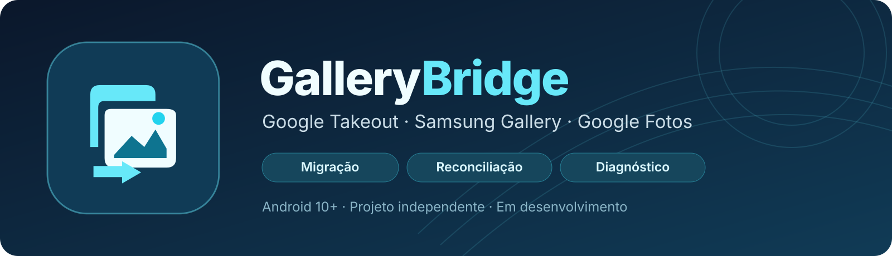

<p align="center">
  
</p>

<p align="center">
  
  
  <a href="https://github.com/igorcv88/GalleryBridge/actions/workflows/android.yml"></a>
  <a href="https://github.com/igorcv88/GalleryBridge/actions/workflows/release.yml"></a>
  <a href="https://github.com/igorcv88/GalleryBridge/releases/latest"></a>
  <a href="https://github.com/igorcv88/GalleryBridge/releases"></a>
  <a href="https://github.com/igorcv88/GalleryBridge/stargazers"></a>
  <a href="LICENSE"></a>
</p>

# GalleryBridge

**Bring your entire Google Photos library into Samsung Gallery without having to rebuild it from scratch.**

GalleryBridge is an Android companion designed to assist users migrating their photo and video libraries from Google Photos to Samsung Gallery, with the goal of preserving original media, capture dates, favorites, location data, album organization, and motion content throughout the transition.

Beyond the initial migration, GalleryBridge provides tools for maintaining and repairing your media library, including duplicate detection, metadata conflict resolution, Live Photo and Motion Photo reconstruction, incorrect date recovery, and Samsung MediaSync troubleshooting.

GalleryBridge works alongside Samsung Gallery's native Google Photos synchronization, helping prepare, organize, verify, and maintain your library while leaving cloud synchronization to the native services.

The main Android app runs on Android 10 or later without root. Native Google Photos synchronization requires a supported Samsung Gallery device and account.

[Releases](https://github.com/igorcv88/GalleryBridge/releases) · [Issues](https://github.com/igorcv88/GalleryBridge/issues) · [License](LICENSE)

## Project status

Version 0.4.1 is experimental. In addition to Takeout ingestion, it includes Motion Photo review, local duplicate review, date-corrected copies, and optional MediaSync diagnostics. JVM and instrumented AOSP tests cover local contracts; end-to-end validation on Galaxy devices and Google Photos is still pending.

> [!IMPORTANT]
> Samsung Gallery may upload the entire media file even when no visible duplicate appears. A 20 GB batch may consume about 20 GB of upload traffic, or more if retries occur. Disable mobile data for Samsung Gallery sync and run your first pilot on Wi-Fi. GalleryBridge's network restrictions apply only to its own app.

## Features

| Feature | What it does |
| --- | --- |
| Takeout audit | Inspect available ZIPs, check completed verification, and compare parts against the Takeout manifest. |
| Exact duplicate detection | Compare ZIP contents and selected local files. Modified copies may appear as separate items. |
| Metadata recovery | Review capture dates, location, captions, orientation, and destination folders for compatible new copies. |
| Historical favorites | Review Takeout favorite flags and mark matching local files with Android 11+ consent. |
| Verification | Separate local presence, local favorites, and your own confirmation of the corresponding Google Photos item. |
| Live Photos and Motion Photos | Match internal identifiers, prepare Motion JPEG, and verify components before publication. Playback requires Galaxy validation. |
| Local duplicate review | Group static JPEGs with identical SHA-256 hashes, keep one copy, and move confirmed redundancies to a review folder. |
| Date repair | Compare Takeout and EXIF dates; save a new compatible JPEG copy with an explicit date and UTC offset. |
| MediaSync diagnostics | With authorized root and a recognized agent profile, inspect the queue, backoff, errors, and last successful sync without writing to the agent database. |

## Installation and first pilot

1. Download the official APK from [Releases](https://github.com/igorcv88/GalleryBridge/releases) when available. Use an emulator or separate test installation for experimental APKs. An APK signed with a different key cannot update an existing installation; preserve any catalog you need.
2. Open [Google Takeout](https://takeout.google.com/), select Google Photos, and request a ZIP export. Keep every part. To test without personal photos, use the [sample archive](fixtures/Takeout-sintetico.zip).
3. In GalleryBridge, open the source section, select the ZIPs, and start or resume verification. Local files and Drive documents can be selected when the Android document provider supports them. If a Drive part fails, download it and select the local copy.
4. In the metadata section, review the pilot and exclude private items. Videos require individual approval. The sample archive should offer two copies and exclude the item in the protected folder.
5. Review and approve a small batch. Keep the app open during preparation; work can be resumed after leaving the screen. Copies appear in `GalleryBridge_NNN` folders under Pictures or Movies.
6. On a supported Galaxy, verify the account and album in Samsung Gallery's sync settings. Compare items on the device and in Google Photos before preparing more batches.

## Recovering favorites

Open the historical favorites review in the metadata section, select the desired items, and confirm the Android dialog. GalleryBridge checks the local favorite flag afterward. If the request is interrupted, reopen the metadata section and reconcile the pending request.

For a cloud-only item, download the existing item through Samsung Gallery if available. Check MediaStore in the batches section if it belonged to a previous batch, then select the downloaded file for local SHA-256 comparison in the source section and return to the favorites preview. Different bytes or ambiguous matches remain under review.

A confirmed Android favorite is a local result. Verify the corresponding item in the correct Google Photos account to confirm the remote favorite.

## Live Photos and Motion Photos

1. After ingesting ZIPs, open Motion Photos and scan for pairs. GalleryBridge checks the internal identifiers of the photo and video. Incomplete, ambiguous, or protected pairs remain under review.
2. If you have the historical motion version, select it before recomposition. A pair is excluded from recomposition when the existing file is proven to contain the same source components.
3. Recompose the pairs on the current page. Copies remain in the app until you approve publication. The original image and video are copied without re-encoding. Test motion and audio in Samsung Gallery after publishing.
4. To review a possible redundancy, select the media to keep, then the recomposed, static, or standalone video candidate. For cloud-only items, use the native app's download when available. GalleryBridge compares the chosen file and does not perform bulk cloud downloads.
5. For a strictly local redundant item, verify the retained photo's attributes and playback. Move an app-created copy to the review album or request that the redundant item be sent to the trash. Android requires consent. The app tracks the local outcome and supports restoration of the last compatible action.

Compatible JPEGs can be recomposed. The reader supports Motion Photo JPEG with XMP and a single-entry Samsung SEF variant. HEIC, HDR with auxiliary data, and unverified structures remain under review. Original Takeout files are preserved. Temporary and verified copies consume device storage.

Deleting synced media may remove it from Google Photos and other devices. Use native Gallery controls for cloud-only items and preserve media when its association is uncertain. Local trash is not evidence of remote deletion.

If you consolidate your library into `DCIM/Archive`, keep organization separate from duplicate review. Reserve `Restored` for individual downloads and `Camera` for captures. The gallery feed combines media from multiple folders. Removing a nonempty album may remove the media it contains.

## Duplicate review and date repair

Select local photos or existing catalog matches in the duplicates section. The current review folder is `Pictures/GalleryBridge_Revisao_Duplicatas`. Reconcile the journal before repeating an interrupted operation. This implementation offers only static JPEGs with identical bytes, up to 48 targets per approval. Favorites, motion, XMP, and unknown formats are protected. Moves use MediaStore, Android consent, and a journal, without permanent deletion. Global cloud-only deduplication and approximate pixel comparison are not implemented.

In the dates section, select a photo, review conflicts with Takeout, enter a date and offset, and save a **new copy**. The original remains unchanged. JPEGs with unverified structures are blocked. There is no bulk date repair directly in Google Photos.

## MediaSync diagnostics

Use the advanced section to open Samsung Gallery and request native sync on Wi-Fi. Optional root diagnostics use a recognized Samsung agent profile and a read-only database connection. The app distinguishes queue progress, backoff, transient errors, and advancement of the last successful sync timestamp.

Local absence, a cache entry, or an empty queue does not establish remote deletion, backup, or integrity. The recovery flow opens Samsung Gallery; it does not delete commits, force sync states, restart services, or bypass thermal limits. Exported diagnostic reports contain sanitized aggregates. See [sync and duplicate review](docs/reconciliacao-e-sync.md) and [Motion Photos](docs/motion-reconciliation.md).

## Dates, albums, and privacy

- Review older photos and travel dates before publication. A date without timezone information remains a local wall-clock time, and Samsung Gallery may sort media differently from Takeout.
- The selected destination folder applies to the local copy. Association with multiple Google Photos albums requires separate verification.
- Motion JPEG preparation is experimental. Test playback in an unsynced folder before using it in a pilot.
- The app keeps its catalog on the device, operates on selected files, and preserves the original ZIPs. Review exported reports before sharing them.
- Automatic space cleanup remains blocked. Preserve originals and verify media in the cloud before using Samsung's free-up-space feature.

## APKs, CI, and releases

- [Releases](https://github.com/igorcv88/GalleryBridge/releases/latest): official signed APK and SHA-256 checksum when available.
- [Actions](https://github.com/igorcv88/GalleryBridge/actions/workflows/android.yml): engine and app unit tests, Android lint, Detekt, and debug/release builds in one cached job. API 30 instrumentation is optional via Run workflow (instrumentation). Each branch push in this repository starts one CI run; newer pushes cancel superseded runs on the same branch. Manual CI runs are also supported. API 37.0 emulator boot is no longer a CI requirement. Successful internal runs produce a signed APK with one-day artifact retention. Fork PRs do not automatically trigger this workflow or receive signing secrets.
- After a PR is merged into `main`, the release workflow repeats the cached unit tests, lint, Detekt and builds, verifies the APK signature, and publishes directly to Releases without emulator startup. Stable releases use the moving `latest` tag. Apply the `release:prerelease` label before merging for a separate pre-release. The release workflow does not upload Actions artifacts.

Official APK updates require the same signing key as the installed APK. Earlier experimental APKs may use a different key. Do not uninstall without preserving your data and catalog. See [CI and signing configuration](docs/ci-release.md).

## Support

When [reporting an issue](https://github.com/igorcv88/GalleryBridge/issues), include your Galaxy model, Android and One UI versions, GalleryBridge version, and the failing step. Do not attach personal photos, real Takeout ZIPs, or private Google Photos links.

GalleryBridge is an independent project, not affiliated with or endorsed by Samsung or Google. The experimental MediaSync LSPosed module is separate from the main app and has [its own requirements](mediasync-experimental/README.md).

## License

GalleryBridge source code is publicly viewable, with all rights reserved. You may cite the project with credit and a link to this repository. Forking is permitted only to the extent allowed by GitHub's Terms of Service. Detaching a fork to make it independent, republishing the code, or reusing it in another project requires prior express permission from Igor (igorcv88). See the [full license](LICENSE) and [third-party notices](THIRD-PARTY-NOTICES.md).

<details>
<summary>Build and technical documentation</summary>

Use JDK 21, Android SDK 36, and Build Tools 36.0.0.

```sh
bash .github/scripts/check-android.sh
./gradlew :app:connectedDebugAndroidTest
apksigner verify --verbose --print-certs app/build/outputs/apk/debug/app-debug.apk
```

- [Feature support matrix](docs/support-matrix.md)
- [CI, signing, and releases](docs/ci-release.md)
- [Reconciliation and test protocol](docs/reconciliation-0.3.1.md)
- [Architecture](docs/architecture.md)
- [Privacy](docs/privacy-and-threats.md)
- [Validation](docs/validation.md)
- [Source provenance](docs/provenance.md)

</details>
